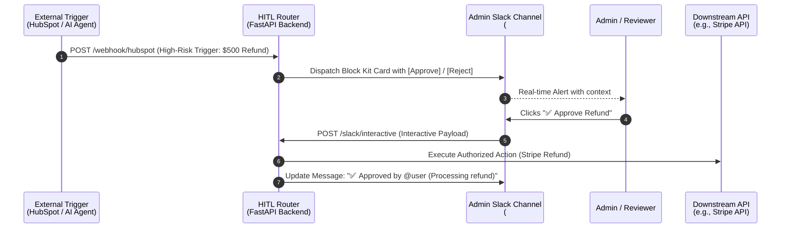

# Enterprise Human-in-the-Loop (HITL) Slack Router

[](https://fastapi.tiangolo.com)
[](https://www.python.org/)
[](https://api.slack.com/block-kit)
[](https://opensource.org/licenses/MIT)

> **A production-ready Human-in-the-Loop (HITL) approval gateway built with FastAPI & Slack Block Kit.**
> Safeguard autonomous AI agents and automated workflows (e.g., HubSpot CRM, LangChain/LlamaIndex agents) by routing high-risk, high-value actions to human administrators via interactive Slack messages.

---

## 📌 Executive Summary

While autonomous workflows and AI agents handle 95% of routine operations, sensitive tasks—such as financial transactions, customer data modifications, or elevated permission grants—require human oversight to mitigate risk and maintain compliance.

**Enterprise HITL Slack Router** provides a lightweight, scalable bridge between automated event triggers and human decision-makers:
- **Instant Human Triage:** Pushes contextual action cards into Slack channels with one-click decision buttons.
- **In-place State Mutation:** Dynamically updates Slack message blocks upon decision, preventing duplicate reviews.
- **Downstream Execution Dispatch:** Integrates with payment processors (Stripe), CRMs (HubSpot, Salesforce), or internal microservices.

---

## 🏗 Architecture & Flow



---

## ⚙️ Features

- ⚡ **High-Performance Async Routing:** Built on FastAPI & HTTPX for ultra-low latency response times.
- 💬 **Interactive Slack Block Kit UI:** Formatted alert cards with risk metadata, dynamic action buttons, and clear intent analysis.
- 🔄 **Safe Idempotency & Message Replacement:** Uses Slack's `response_url` with `replace_original: true` to prevent double-clicks and provide real-time status visibility.
- 🛡 **Extensible Enterprise Guardrails:** Ready for Slack HMAC signature verification (`X-Slack-Signature`) and multi-tier role-based approvals.

---

## 🚀 Quick Start

### 1. Prerequisites
- Python 3.11+
- A Slack Workspace with permissions to install/create apps
- [ngrok](https://ngrok.com/) (for local development & webhooks)

### 2. Installation
```bash
# Clone the repository
git clone https://github.com/knmgn/enterprise-hitl-slack-router.git
cd enterprise-hitl-slack-router

# Create virtual environment (optional)
python -m venv venv
# On Windows:
venv\Scripts\activate
# On macOS/Linux:
source venv/bin/activate

# Install dependencies
pip install -r requirements.txt
```

### 3. Configure Environment Variables
Copy the sample environment file and configure your Slack Incoming Webhook URL:
```bash
cp .env.example .env
```
Edit `.env`:
```env
SLACK_WEBHOOK_URL="https://hooks.slack.com/services/<YOUR>/<WEBHOOK>/<URL>"
```

### 4. Run the Server
```bash
uvicorn main:app --reload --port 8000
```

### 5. Expose with ngrok
```bash
ngrok http 8000
```
Copy your generated forwarding URL (e.g. `https://xxxx.ngrok-free.app`).

### 6. Configure Slack App Interactivity
1. Go to your [Slack API App Dashboard](https://api.slack.com/apps).
2. Navigate to **Interactivity & Shortcuts**.
3. Toggle **Interactivity** to **On**.
4. Set **Request URL** to:
   ```
   https://<your-ngrok-domain>/slack/interactive
   ```
5. Click **Save Changes**.

---

## 🧪 Testing the HITL Flow

Trigger an simulated high-risk event from HubSpot / AI Agent:

```bash
# cURL
curl -X POST http://localhost:8000/webhook/hubspot

# Or PowerShell
Invoke-RestMethod -Uri "http://localhost:8000/webhook/hubspot" -Method Post
```

### Result:
1. An alert block appears in Slack `#alert-admin-approvals`.
2. Click **✅ Approve Refund** or **❌ Reject**.
3. The card updates dynamically with reviewer identity and downstream status.

---

## 🗺 Roadmap / Production Enhancements

- [ ] Slack Request Verification (`v0` HMAC-SHA256 signature check)
- [ ] Audit Logging to PostgreSQL / BigQuery for compliance tracking
- [ ] Multi-reviewer consensus policy (require 2+ approvals for actions > $10,000)
- [ ] Direct Stripe API integration for automated settlement

---

## 📄 License
This project is open-source and available under the [MIT License](LICENSE).
