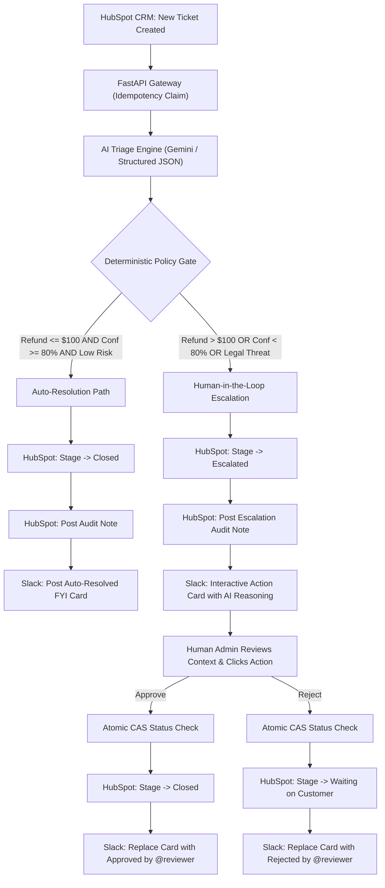

# Enterprise Human-in-the-Loop (HITL) Router

[](https://fastapi.tiangolo.com)
[](https://www.python.org/)
[](https://developers.hubspot.com/)
[](https://api.slack.com/block-kit)
[](https://ai.google.dev/)
[](https://opensource.org/licenses/MIT)

> **A production-grade AI Triage & Human-in-the-Loop (HITL) approval gateway connecting HubSpot CRM and Slack.**
> Prevents AI hallucination damage and workflow errors by enforcing strict, deterministic code guardrails over automated actions—escalating high-risk or low-confidence tickets to human reviewers via interactive Slack Block Kit cards.

---

## 📺 Live Demo (88s)

https://github.com/user-attachments/assets/8dece56e-620f-4814-b54a-cc1e0bdad102

---

## 📌 Executive Summary

Modern AI-driven customer operations can automate routine inquiries, but enterprise safety demands that **high-risk actions** (e.g., financial refunds, legal disputes, sensitive account changes) are protected by a reliable human safety net.

This system answers the key question in enterprise workflow architecture:  
**"When an AI agent is uncertain or an action exceeds risk thresholds, does it guess—or does it hand off to a human?"**

### Key Capabilities
- 🤖 **Structured AI Triage (Gemini):** Classifies intent, detects refund amounts, assesses risk level, and calculates confidence score (0.0–1.0) with plain-English reasoning.
- 🛡 **Deterministic Code Guardrails:** Business policies (e.g., refund > $100, confidence < 80%, legal threats) are **hardcoded in Python policy rules**—never left to the LLM's discretion.
- ⚡ **Auto-Resolution vs. Human Escalation:**
  - **Low-Risk & High Confidence:** Auto-resolves in HubSpot CRM and posts an FYI audit card to Slack.
  - **High-Risk or Low Confidence:** Updates ticket to Escalated in HubSpot, attaches audit notes, and sends interactive approval buttons to Slack.
- 🔒 **Idempotency & Double-Click Prevention:** Backed by SQLite CAS (Compare-And-Swap) transitions; reviewers cannot double-approve, and retried webhooks do not duplicate messages.
- 📝 **Full HubSpot Bidirectional Sync:** Ticket pipeline stages and audit notes update automatically upon reviewer decision.

---

## 🏗 Architecture & Decision Flow



---

## 🎭 The 3 Built-in Demo Scenarios

| Scenario | Details | AI Analysis | Route |
| :--- | :--- | :--- | :--- |
| **1. Small Refund** | Jane Smith asks for $30 refund for chipped mug | Category: `refund_request`<br>Risk: `low`<br>Confidence: `95%` | 🟢 **Auto-resolved** in CRM without human friction |
| **2. High-Value Refund** | John Doe asks for $500 refund for duplicate charge | Category: `refund_request`<br>Amount: `$500`<br>Confidence: `90%` | 🚨 **Escalated to Slack** (Exceeds $100 threshold) |
| **3. Ambiguous Complaint** | Alex Morgan mentions lawyer and demands resolution | Category: `legal_threat`<br>Confidence: `60%`<br>Risk: `high` | 🚨 **Escalated to Slack** (Low confidence & high risk) |

---

## 🚀 Quick Start

### 1. Prerequisites
- Python 3.11+
- A Slack workspace with an Incoming Webhook & App configured
- A HubSpot free CRM portal with a Service Key created
- (Optional) Gemini API Key (falls back to built-in rule engine if unset)

### 2. Setup
```bash
git clone https://github.com/knmgn/enterprise-hitl-slack-router.git
cd enterprise-hitl-slack-router

pip install -r requirements.txt
cp .env.example .env
```

Configure `.env` with your tokens (see `.env.example`).

### 3. Run Test Suite
```bash
pytest
```
*Validates 14 policy unit tests, JSON normalization, and Slack HMAC replay-attack protection.*

### 4. Start Server
```bash
uvicorn main:app --reload --port 8000
```

### 5. Expose & Configure Slack
```bash
ngrok http 8000
```
In your [Slack API App Console](https://api.slack.com/apps), navigate to **Interactivity & Shortcuts** and set **Request URL** to:
```text
https://<your-ngrok-domain>/slack/interactive
```

### 6. Run Demo Seeds
Generate realistic test cases in your HubSpot portal:
```bash
# Seed all 3 scenarios at once
python seed_demo.py all

# Or individually
python seed_demo.py small
python seed_demo.py large
python seed_demo.py ambiguous

# Clean up demo tickets after filming
python seed_demo.py cleanup
```

---

## 🛡 Production Hardening Highlights

- **Fail-Safe Design:** If Gemini API fails or experiences rate-limiting, the system automatically treats the ticket as zero-confidence and escalates to a human instead of failing silently.
- **Prompt Injection Defense:** Customer ticket body is isolated as raw data; output follows strict JSON Schema and is validated before policy evaluation.
- **Slack Replay Attack Protection:** Verifies `X-Slack-Signature` and timestamp within a 5-minute sliding window.

---

## 📄 License
MIT License. Free to adapt for production workflows.
